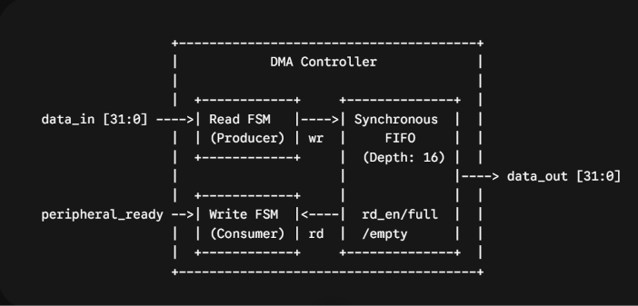
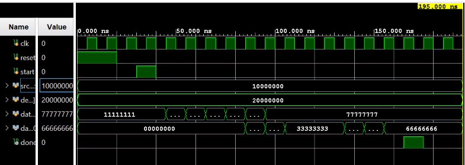

# 32-Bit Burst DMA Controller (Verilog)

A DMA controller that moves a burst of 32-bit words from a source to a destination peripheral. A 16-entry synchronous FIFO sits between the read and write sides, so the source can keep filling while the destination is stalled, and no data is lost under backpressure.

## Design

- **Control FSM** (`IDLE → RUN → DONE`) starts on `start`, tracks words pushed (`read_count`) and popped (`write_count`), and pulses `done` after the last word of `burst_size` leaves the FIFO.
- **Push side:** writes into the FIFO whenever it is not full and fewer than `burst_size` words have been read.
- **Pop side:** reads from the FIFO only when it is not empty and `peripheral_ready` is high.
- **FIFO:** parameterized width and depth (32 x 16 here), separate read/write pointers, an occupancy counter, and `full`/`empty` flags. Simultaneous push and pop are handled in the same cycle.

| Signal | Dir | Description |
|---|---|---|
| `start` | in | Begin a burst transfer |
| `burst_size[7:0]` | in | Number of words to move |
| `data_in[31:0]` | in | Data from the source |
| `peripheral_ready` | in | Destination can accept data (backpressure) |
| `data_out[31:0]` | out | Data to the destination |
| `dma_valid` | out | FIFO holds data to send |
| `done` | out | One-cycle pulse when the burst completes |

## Verification

The directed testbench (`tb/dma_controller_tb.v`) runs a 6-word burst at 100 MHz and checks three cases:

1. **Destination stalled at start:** `peripheral_ready` held low so the FIFO fills before any data leaves.
2. **Destination ready:** buffered words drain in order.
3. **Mid-burst stall:** `peripheral_ready` drops for 2 cycles, the FIFO holds the data, and the transfer resumes with no lost words.

Data comes in as `11111111`, `22222222`, `33333333`, ... and leaves in the same order, with `done` pulsing once after the final word.

## Run It

1. Create a Vivado project and add `rtl/dma_controller.v` and `rtl/fifo_buffer.v` as design sources.
2. Add `tb/dma_controller_tb.v` as a simulation source and set it as top.
3. Run **Behavioral Simulation**.

## Next Steps

- Self-checking testbench with a scoreboard
- SystemVerilog/UVM testbench with constrained-random stalls and functional coverage
- SystemVerilog Assertions for FIFO and handshake rules

## Tools

Verilog · Xilinx Vivado
